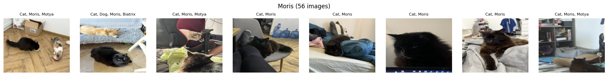
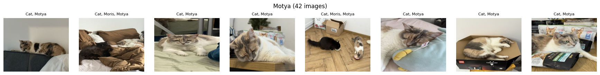
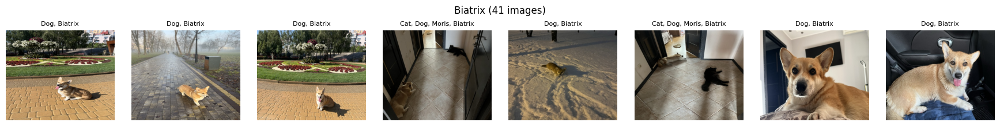
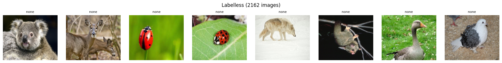
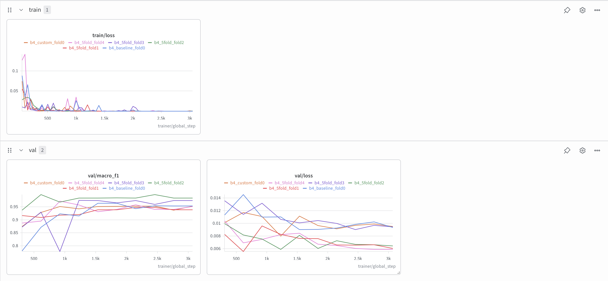
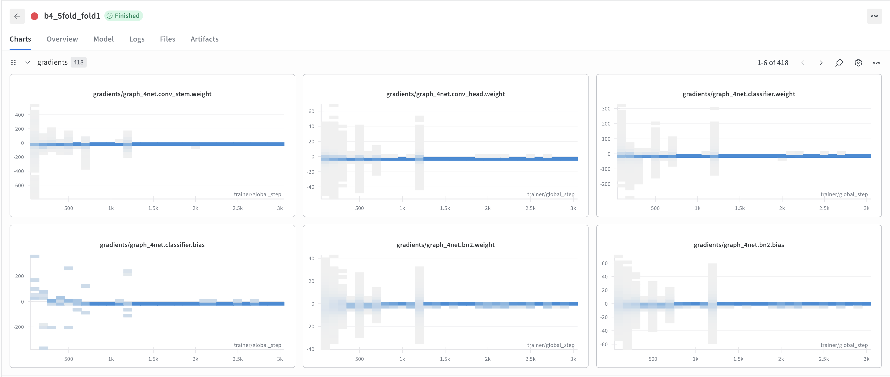
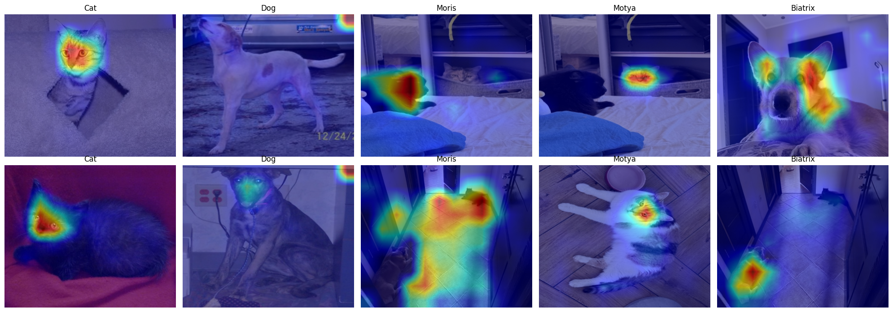

# Deep Learning HW 2
Author: Daniel Bond

## Task and Data
Task: Kaggle competition - multi-label image classification. 12260 train and 18673 test images (450x375 RGB JPEGs), each with 5 binary labels: `Cat`, `Dog`, `Moris`, `Motya` (cats) and `Biatrix` (dog). Evaluated with macro F1 over the 5 columns.

Notebooks: [DL-HW2-Part1.ipynb](./DL-HW2-Part1.ipynb) - EDA and metric analysis, [DL-HW2-Part2.ipynb](./DL-HW2-Part2.ipynb) - validation, models, ensembling (ran on Colab, T4 GPU).

### Data analysis

| Label | Positives | Share |
|---|---|---|
| Cat | 5077 | 41.41% |
| Dog | 5025 | 40.99% |
| Moris | 56 | 0.46% |
| Motya | 42 | 0.34% |
| Biatrix | 41 | 0.33% |
| No label | 2162 | 17.63% |

The labels are nested: `Moris` and `Motya` never appear without `Cat`, and `Biatrix` never appears without `Dog`. Pets can appear together: 10 images have both `Moris` and `Motya`, and the only 4 images with both a cat and a dog are `Moris` + `Biatrix`.

17.6% of the images have no label at all - these are other animals, some of them similar to cats or dogs.

The pet photos look different from the rest of the data: modern phone photos from one home, and generic cats and dogs are often lower-quality photos. Moris is a black cat, Motya a light cat, Biatrix a corgy.






All images are 450x375 RGB. Test has 1.5x more images than train.

## Metric Analysis

Kaggle evaluates submissions with macro F1

Strengths:

- Equal weight for all classes, so recognizing individual pets is an important part of the score.
- Ignores true negatives, so images without any label or a specific pet do not impair the score's representativeness.
- Balances precision and recall.

Weaknesses:

- 60% of the score comes from the three pet columns (~1% of the labels).
- Needs threshold tuning for binary predictions.
- Very noisy on rare classes - small differences can be pure noise.
- Not usable as loss for training directly, so used BCE.
- Label hierarchy is not considered: predicting `Moris` without `Cat` is only a false negative for `Cat`, not a logical error - Moris is a cat.

### Edge cases
- A class that with 0 predictions scores 0.
- A validation fold without positives - needs stratified folds.

### Complementary metrics
Per-class F1, precision and recall, micro F1: show which classes influence the macro score.

Per-class PR-AUC: needs no threshold, informative for rare positives.

BCE/LogLoss: the actual training loss, measures probability quality.

Alternative metric: macro PR-AUC - keeps equal weight per class as the main metric, doesn't need thresholds and stays informative with few positives, unlike ROC-AUC.

## Validation

Strategy: multilabel-stratified 5-fold CV.

| Fold | Cat | Dog | Moris | Motya | Biatrix | Images |
|---|---|---|---|---|---|---|
| 0 | 1016 | 1005 | 11 | 9 | 8 | 2452 |
| 1 | 1016 | 1005 | 12 | 9 | 8 | 2452 |
| 2 | 1015 | 1005 | 11 | 8 | 8 | 2452 |
| 3 | 1015 | 1005 | 11 | 8 | 8 | 2452 |
| 4 | 1015 | 1005 | 11 | 8 | 9 | 2452 |

Correlation with LB: expected close, but lower and noisy - somewhat proved by actual scores. Public LB is 33% of test - small amount of positives, and each error impacts the score.

Adversarial validation: AUC 0.5029 - train and test come from the same distribution.

Local vs leaderboard:

| Model | CV macro F1 | Public LB |
|---|---|---|
| B4 5-fold @0.5 | 0.9717 ± 0.0161 | 0.94541 |
| B4 5-fold, tuned thresholds | 0.9753 | 0.95743 |

The gap is consistent and in the expected direction.

## CNN Model

Model: `efficientnet_b4.ra2_in1k` - ImageNet-1k weights only, trained at 320 and evaluated at 384, which is close to the 450x375 images. 17.6M parameters. The head outputs 5 logits with sigmoid + `BCEWithLogitsLoss`, as the task is multi-label.

| Parameter | Value |
|---|---|
| Input size | 320x384 (keeps the aspect ratio) |
| Augmentations | `RandomResizedCrop(scale=0.7-1.0)`, horizontal flip (no colour changes - Moris and Motya differ mostly by colour) |
| Optimizer | AdamW, lr 3e-4 |
| Scheduler | Constant, then cosine annealing |
| Batch size / epochs | 32 / 10 |
| Precision | 16-mixed |
| Checkpoint | best epoch by validation macro F1 |

Infrastructure: PyTorch Lightning, W&B logging (losses, macro F1, gradient histograms via `logger.watch`), Colab T4.

### Experiments

| Experiment | CV macro F1 | Public LB |
|---|---|---|
| B4, constant lr, fold 0 | 0.9435 | 0.92381 |
| B4, cosine, fold 0 | 0.9585 | 0.91851 |
| B4, cosine, 5-fold @0.5 | 0.9717 ± 0.0161 | 0.94541 |
| B4, cosine, 5-fold, tuned thresholds | 0.9753 | **0.95743** |

Per-class F1 on fold 0:

| Experiment | Cat | Dog | Moris | Motya | Biatrix |
|---|---|---|---|---|---|
| Constant lr | 0.9881 | 0.9916 | 0.8571 | 0.9474 | 0.9333 |
| Cosine | 0.9916 | 0.9915 | 0.9524 | 1.0000 | 0.8571 |

`Cat` and `Dog` are almost solved by any setup - the score is decided by the pets.

### Training curves



- Validation macro F1 levels epoch 4, and the difference between folds is larger than the difference between epochs.
- Validation loss reaches its minimum around epochs 4-5 and stays flat.
- Fold 0 log in W&B mixes three trainings on the same fold.

### Gradient flow



- The spread is wide in the first ~1k steps and narrows to 0, matching the training loss going to 0.
- Other folds look the same.

### Thresholds

Tuned per class on the 5-fold out-of-fold predictions (grid 0.05-0.95):

| Cat | Dog | Moris | Motya | Biatrix |
|---|---|---|---|---|
| 0.55 | 0.35 | 0.30 | 0.25 | 0.35 |

Tuning added +0.004 on CV and +0.012 on the leaderboard.

Conclusion: the model is adequate. Validation is stable across folds and adversarial validation shows train and test are close. The 5-fold average was the largest single improvement.

## Custom Block

Spatial attention added after the last feature map of B4, before pooling. 99 extra parameters.

```python
class SpatialAttention(nn.Module):
    def __init__(self):
        super().__init__()
        self.conv = nn.Conv2d(2, 1, kernel_size=7, padding=3)

    def forward(self, x):
        pooled = torch.cat([x.mean(dim=1, keepdim=True), x.amax(dim=1, keepdim=True)], dim=1)
        return x * torch.sigmoid(self.conv(pooled))
```

Compared on fold 0 with the same setup (the plain B4 is the fold-0 model of the 5-fold run):

| Model | Fold 0 @0.5 | Fold 0 tuned | Public LB |
|---|---|---|---|
| B4 | 0.9647 | 0.9649 | 0.91851 (separate fold-0 cosine run) |
| B4 + spatial attention | 0.9530 | 0.9643 | 0.92514 |

Inconclusive: worse on CV at 0.5, equal with tuned thresholds, slightly better on the leaderboard.

### GradCAM



- The model mostly looks at the animals' heads.
- On the same image with both cats, the `Moris` map highlights the black cat and the `Motya` map the light one - the model distinguishes individual pets.
- `Dog` maps show a hotspot in the top-right corner of the image, looks like some shortcut.
- In a dark photo `Moris` attention spreads over the floor - the model partly relies on the scene.

## Ensembling

Average of probabilities: B4 5-fold + B4 with spatial attention (fold 0). Thresholds are the ones tuned on the B4 5-fold OOF.

| Model | Fold 0 @0.5 | Fold 0 tuned | Public LB @0.5 | Public LB tuned |
|---|---|---|---|---|
| B4 (5-fold) | 0.9647 | 0.9649 | 0.94541 | 0.95743 |
| B4 + spatial attention | 0.9530 | 0.9643 | 0.92514 | - |
| Ensemble | 0.9529 | 0.9767 | 0.93135 | 0.95498 |

The ensemble is worse than B4 5-fold alone on the leaderboard, but if I had more time I would like to try ensembling of both 5-fold models.

## Final Results

| Model | CV macro F1 | Public LB |
|---|---|---|
| B4, constant lr, fold 0 | 0.9435 | 0.92381 |
| B4, cosine, fold 0 | 0.9585 | 0.91851 |
| B4 + spatial attention, fold 0 | 0.9530 | 0.92514 |
| B4 5-fold @0.5 | 0.9717 | 0.94541 |
| **B4 5-fold, tuned thresholds** | **0.9753** | **0.95743** |
| Ensemble @0.5 (fold 0) | 0.9529 | 0.93135 |
| Ensemble, tuned (fold 0) | 0.9767 | 0.95498 |

Conclusions
- Averaging 5 fold models and tuning per-class thresholds gave the largest gains.
- Single-fold scores are too noisy to compare experiments on this data.
- GradCAM confirms the model separates individual pets by looking at the animals.

## Failed Ideas

What did not work
- Cosine scheduler on a single fold: better CV, worse leaderboard - no clear effect.
- Spatial attention block: no consistent improvement.
- Ensemble with a single-fold model: worse than the 5-fold B4 alone.

Limitations
- The custom block was trained on fold 0 only.
- Small tuning budget: one backbone, one learning rate, no test-time augmentation.

## AI Usage

All links to AI chats provided in [ai_usage.txt](./ai_usage.txt) file.
